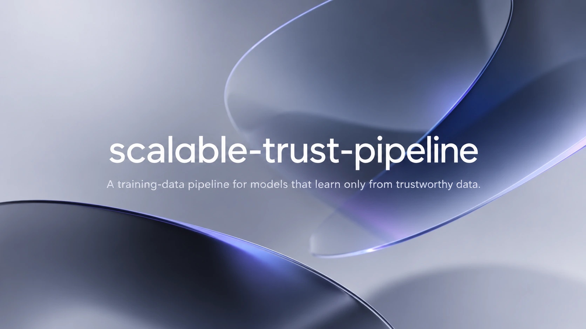
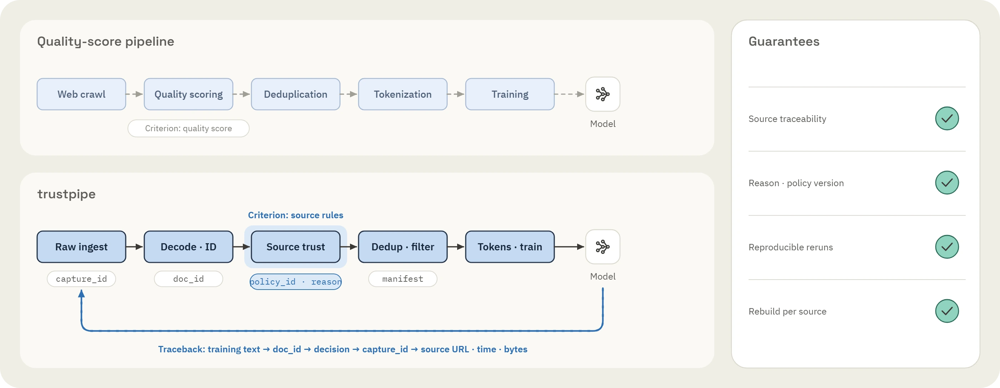
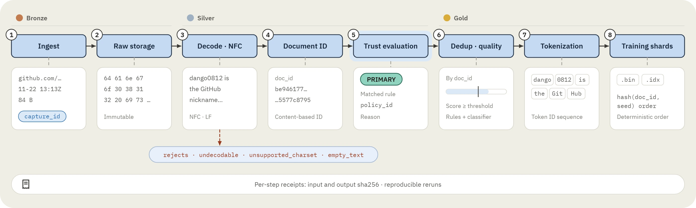

# scalable-trust-pipeline

English | [한국어](./README-ko_kr.md)  

A training-data pipeline for models that learn only from trustworthy data.

Models are fine-tuned and evaluated on this data in [scalable-trust-model](https://github.com/dango0812/scalable-trust-model).

## Compared with a quality-score pipeline

## Processing steps

## System architecture

## Scaling

